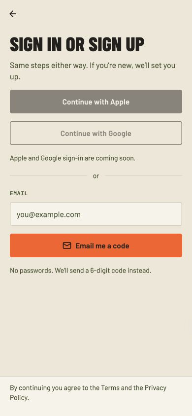
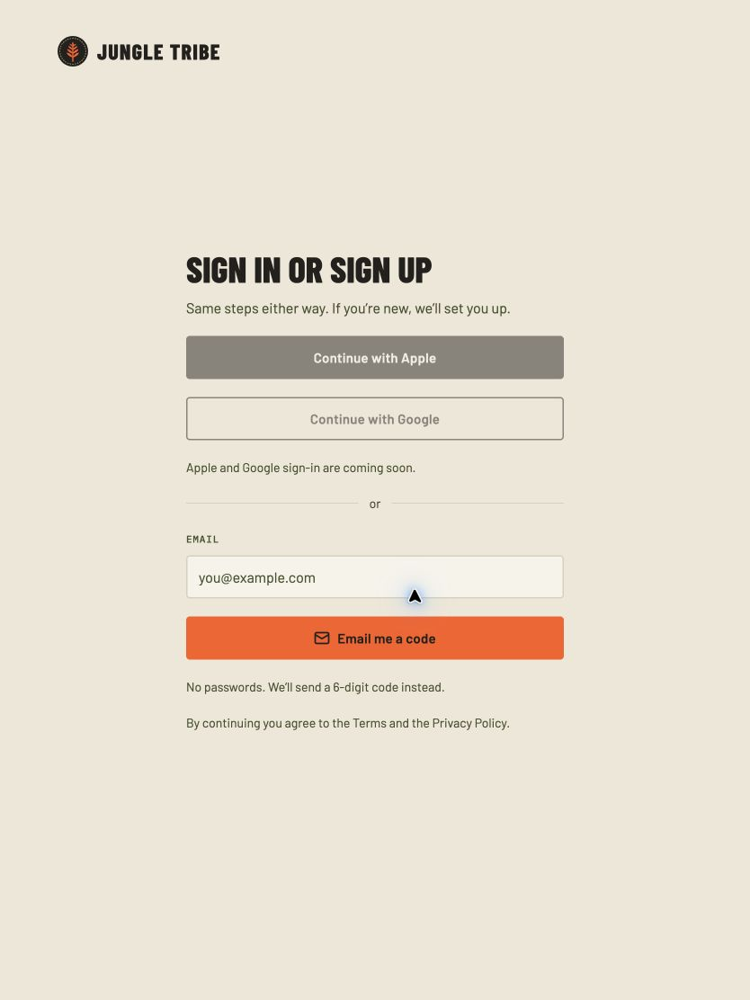
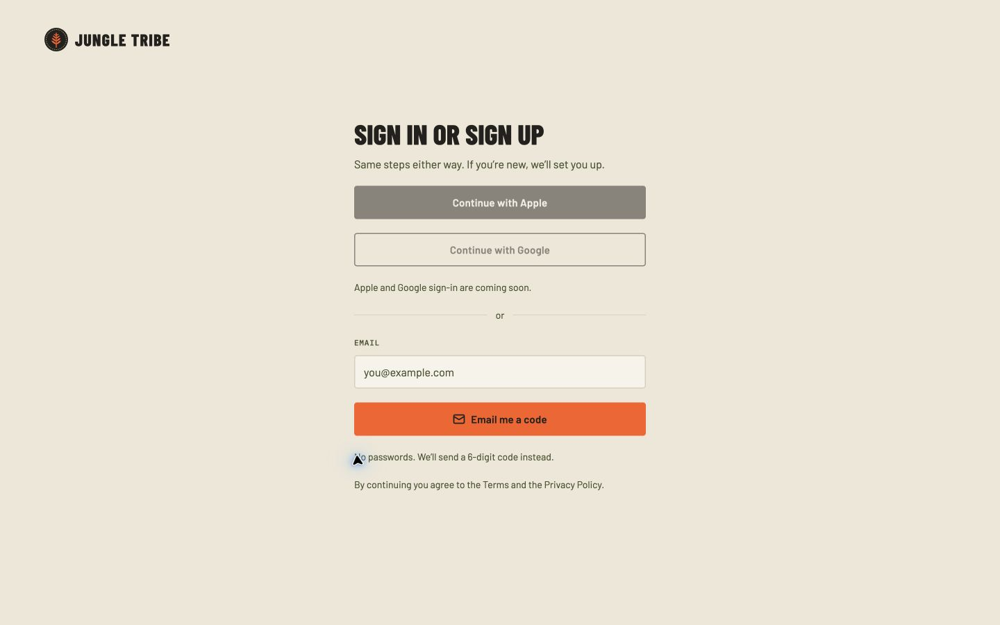
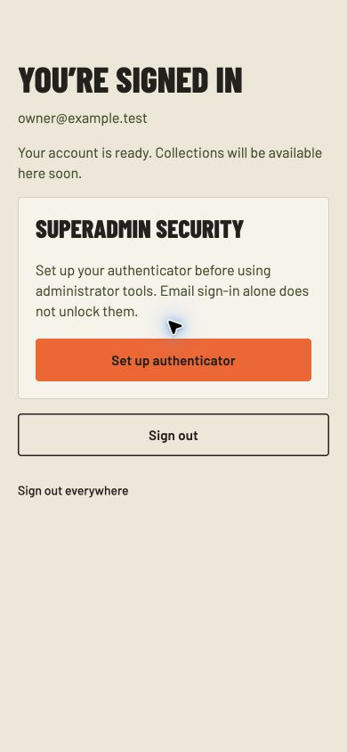
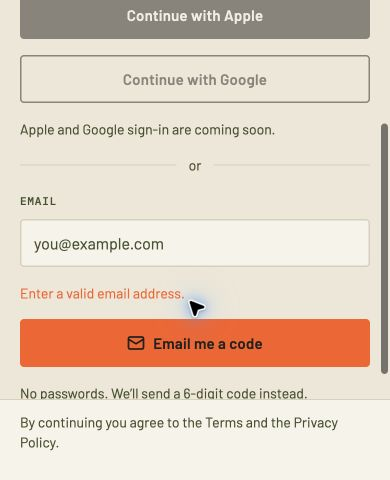

# Authentication verification — November 4, 2026

Scope: #48, following merged server PR #47. Screens were implemented from the approved Figma onboarding frames 73:10/40, 73:70/100, 73:143/170 and 73:208 in file RMn934uedk5Jdvg01jOrb3. No Figma document was changed.

## Responsive inspection

| View | Browser viewport | Result |
| --- | --- | --- |
| Mobile | 390 × 844 | 350px form; 20px page inset; no horizontal overflow |
| Tablet | 834 × 1112 | Centered 420px panel; no horizontal overflow |
| Desktop | 1440 × 900 | Centered 420px panel; logo at 64px/40px; no horizontal overflow |
| Reduced-height mobile | 390 × 480 | Form scrolls; the main action remains reachable above the legal footer |

Measured actual DOM/object bounds and computed layout: primary, signal and outline buttons are 48px tall with 24px horizontal/12px vertical padding. The field uses a 20px label line, 8px label gap, 48px input and 14px horizontal input inset. Stroke overlays preserve those measurements rather than adding border pixels. The owner notice has a measured 20px content inset. Code boxes measure 48 × 58 at the approved sizes; touch controls, wrapping, logo/icon slots and welcome-photo crops were inspected. Fonts are the supplied Barlow, Barlow Condensed and IBM Plex Mono weights, imported individually. All static Figma images are nonempty local files. Repeated SVG exports were compared by hash and reused only when byte-identical; source SVG roots were not edited.

Apple/Google controls are visibly disabled with an availability explanation because the owner explicitly deferred their registrations. The code label says “Sign-in code” instead of promising unimplemented profile/collection onboarding steps. Resend/expired messages claim a fresh delivery only after the server accepts it. Shared control measurements follow the repository’s approved component contract.

## Behavior evidence

A loopback-only fixture with fake delivery and a disposable PostgreSQL schema verified: normal sign-in, six-digit paste, incorrect-code feedback, session persistence after page reload, sign out everywhere, owner sign-in showing MFA enrollment rather than granting administration, and welcome/back navigation. Real sender credentials were never used by this fixture. MFA QR/secret/recovery material was not captured in screenshots.

The HTTP suite contains 15 passing scenarios, including atomic code consumption, expiry/replay rejection, persistent quotas, credentialed origin checks, provider failure, all-session revocation, superadmin enrollment and session-bound freshness, one-use recovery, account-bound factor limits, native-style requests, and rejection of an already-used TOTP on a new session. Better Auth verifies the factors; application policy gates grants and proofs.

Local lint, strict types, Next.js build and Expo web/iOS/Android exports pass. Expo dependency checks pass. Native SecureStore wiring and native-style API behavior are verified at code/export/HTTP levels; no device/simulator runtime acceptance is claimed because full Xcode is unavailable on this machine. Actual owner enrollment happens on the owner’s device after hosted staging verification.

